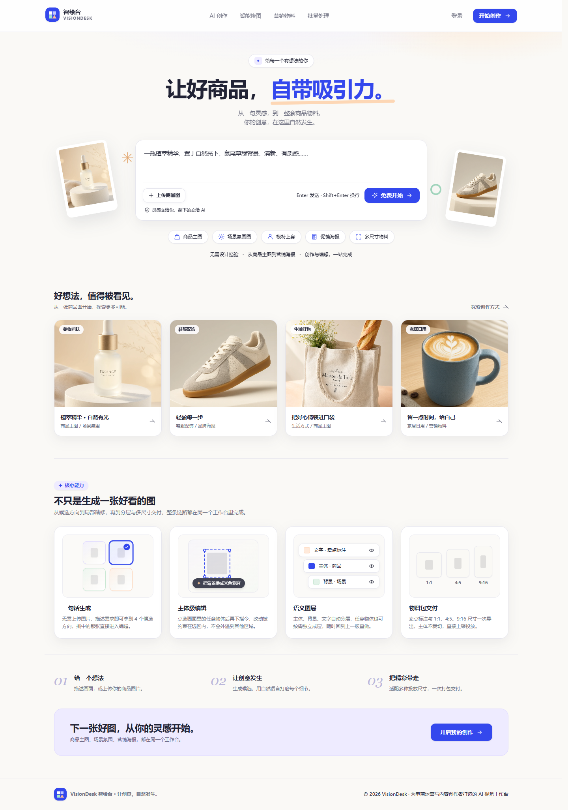
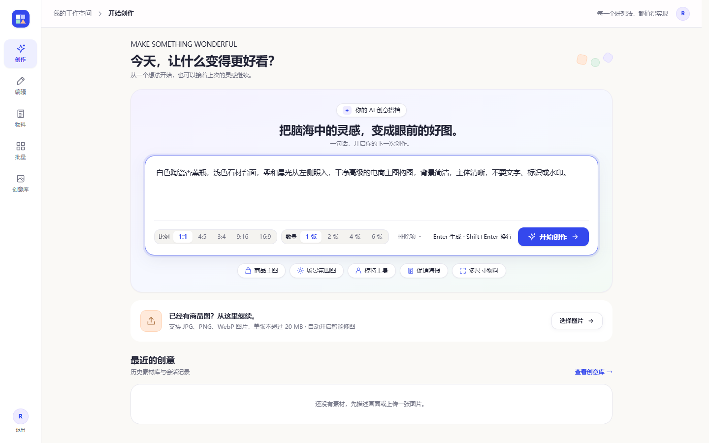
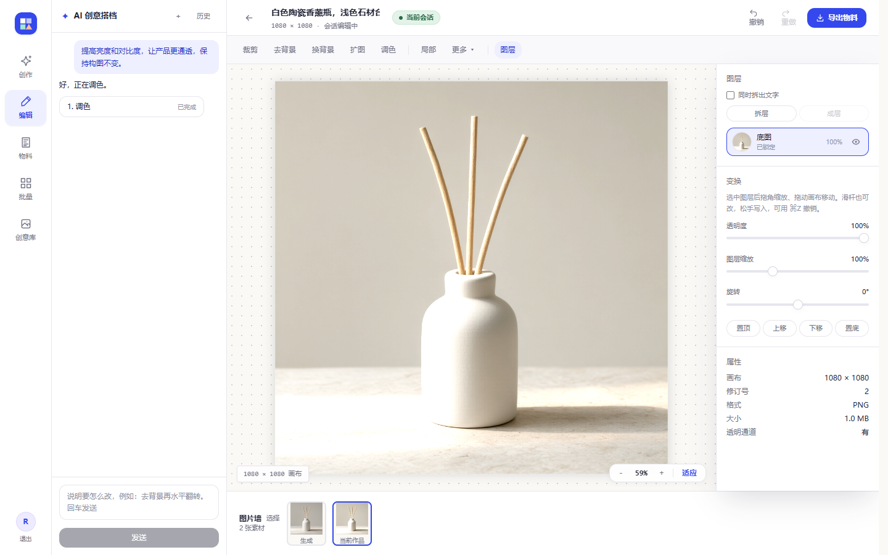
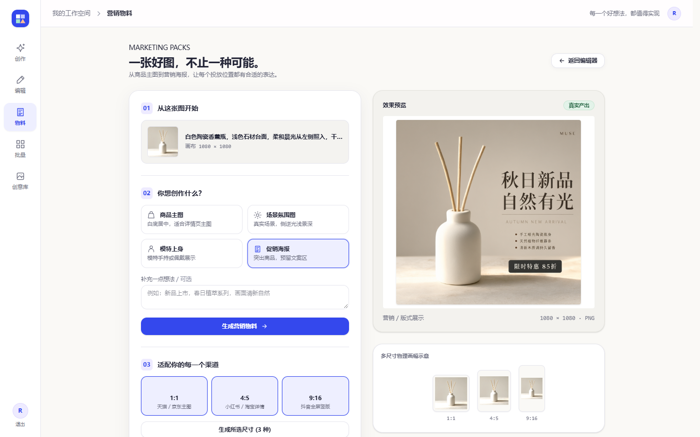
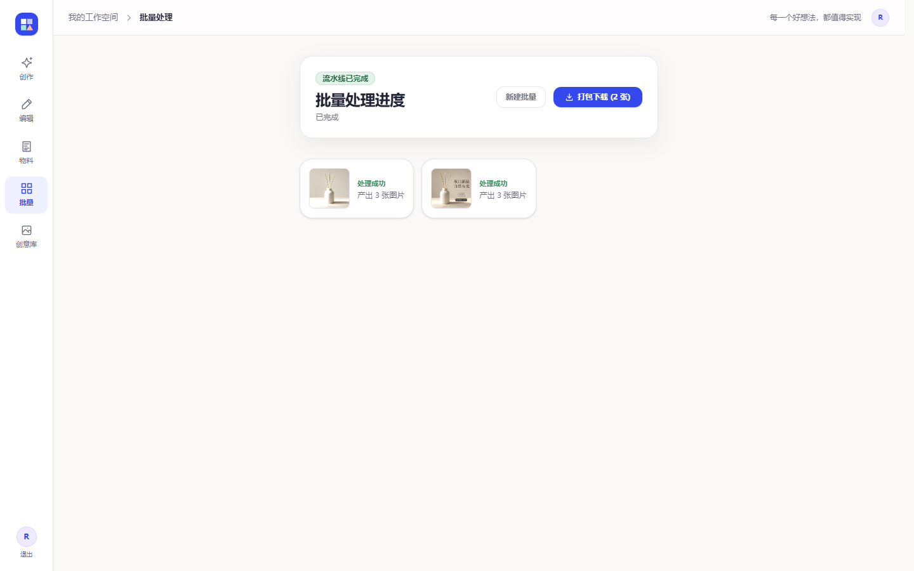
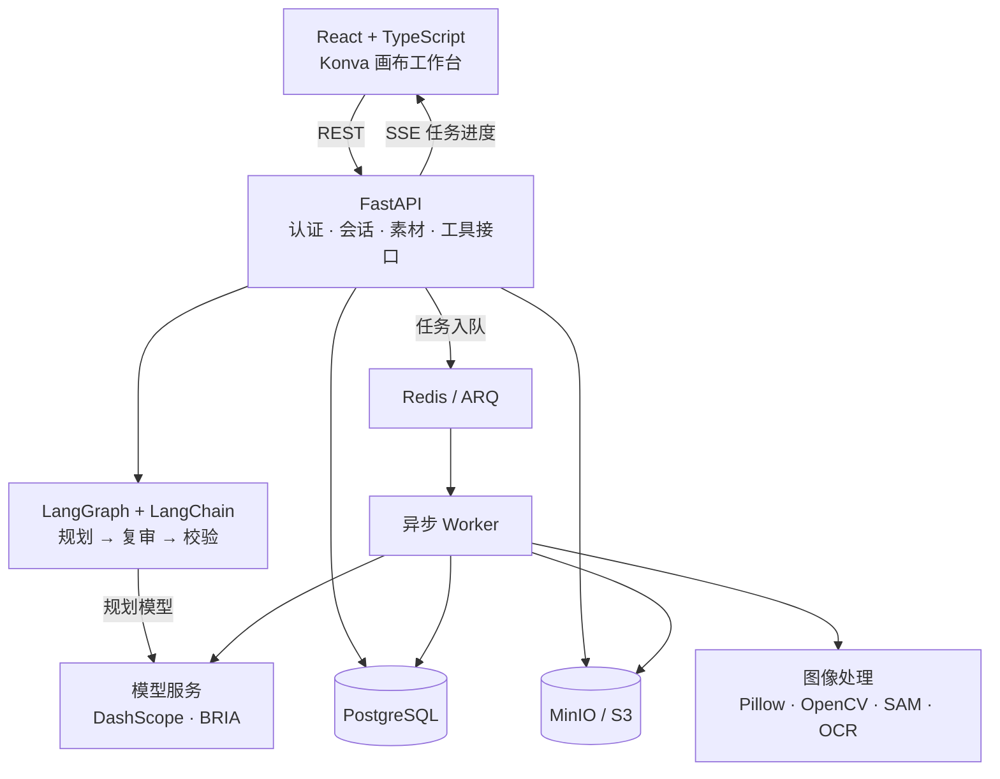

<div align="center">

# VisionDesk · 智绘台

**从一句想法，到一套可用的商品物料。**

基于 React 19、FastAPI、LangGraph 与 Konva 构建的 AI 图片创作与编辑工作台。通过自然语言组织修图任务，在同一工作区完成图像生成、局部编辑、图层处理、营销物料制作与批量导出。


</div>

> Author: Jan-mx
> Status: Active
> Updated: 2026-11-04



## 从创作到交付，在一个工作台完成

商品图片通常需要经历多次处理：生成初稿、修改局部、调整背景、制作海报，再适配不同投放尺寸。

VisionDesk 将这些操作连接成一条连续的工作流：

**描述或上传 → 选择候选 → Agent 修图 → 图层精修 → 营销物料 → 批量交付**

你可以直接操作画布，也可以用自然语言描述目标。Agent 根据当前图片、图层、选区和对话上下文组织工具步骤；执行结果保留在会话与图片墙中，便于继续修改、切换和复用。

## 真实工作流

> 以下界面截图来自当前版本的实际运行环境，使用独立演示账号。文生图与营销图由真实模型生成，Agent 编辑与批量任务均实际执行。

### 1. 从描述或已有图片开始

输入画面描述，选择比例与候选数量，生成商品图的初始方向；已有素材也可以直接上传进入编辑器。

> 示例：白色陶瓷香薰瓶，浅色石材台面，柔和晨光，简洁的电商主图构图。



### 2. 用自然语言组织编辑，用画布控制细节

采用候选图后，进入包含 Agent 对话、画布、工具栏、图层面板和图片墙的编辑工作区。

例如：

> 提高亮度和对比度，让产品更通透，保持构图不变。

简单操作可以直接执行；多步计划先展示步骤供用户确认。任务运行时，界面持续显示阶段和进度，完成后继续在当前会话编辑。



### 3. 从一张商品图延展营销表达

以当前画布为参考，生成商品主图、场景氛围图、模特展示图和促销海报。生成结果进入图片墙，可选择预览、继续编辑或打包导出。

投放尺寸支持：

| 比例 | 输出尺寸 |
| --- | --- |
| 1:1 | 1080 × 1080 |
| 4:5 | 1080 × 1350 |
| 9:16 | 1080 × 1920 |



### 4. 将重复处理变成批量任务

选择多张素材，组合去背景、换背景、调色、超分、扩图和投放尺寸等步骤，交由异步 Worker 执行。

任务页展示每张图片的处理状态和输出，完成后可统一下载物料包。



## 项目特色

### 理解画布上下文的 Agent

Agent 接收的不只有一句提示词，还包含当前画布、选中图层、已有选区和最近对话等信息。

LangGraph 将规划、复审和参数校验串联起来，通过统一工具注册表生成可执行步骤。多步计划支持确认、取消和失败重试，步骤之间可以传递前序产物。

### 结合选区与语义图层的编辑方式

选区决定修改范围，图层决定操作对象。支持点选、笔刷选区、区域消除与替换，也可以拆分主体和背景、将对象提升为独立图层。

图层可继续移动、缩放、旋转、调整透明度和层级；文字层支持文案修改。像素结果与画布布局共同构成后续编辑的上下文。

### 可继续创作的素材与历史

会话、图片墙和创意库连接原图、生成结果与当前作品。编辑历史支持撤销和重做，素材可以继续用于营销生成、尺寸适配和批量处理。

### 可观察的异步执行

FastAPI 处理请求与业务校验，Redis 和 ARQ 调度耗时任务，Worker 执行模型调用及图像处理。

前端通过 SSE 接收任务进度，展示排队、执行、完成或失败状态，无需一直阻塞在请求页面。

### 创作端与管理端

除创作工作台外，项目还提供受权限保护的后台管理模块，包含用户维护、素材治理、工具任务、Agent 轮次和操作记录查询。

## 23 种工具能力

| 分类 | 能力 |
| --- | --- |
| 图像生成与增强 | 文生图、换背景、扩图、超分、去背景、调色 |
| 区域与语义处理 | 区域消除、区域替换、图层拆分、对象提层、多颜色主体 |
| 营销与交付 | 营销图生成、投放尺寸、批量处理 |
| 画布与图层 | 裁剪、翻转、透明度、显隐、文字修改、层级重排、缩放、旋转、移动 |

工具集中注册于 `backend/app/tools/`，Agent 规划与运行时调度使用同一套工具定义。

## 系统架构



| 层级 | 技术 |
| --- | --- |
| 前端 | React 19、TypeScript、Vite、Tailwind CSS |
| 数据与状态 | TanStack Query、Zustand |
| 画布 | Konva、react-konva |
| API 与持久化 | FastAPI、Pydantic、SQLAlchemy Async、Alembic |
| Agent | LangChain Core、LangGraph |
| 异步执行 | Redis、ARQ、SSE |
| 文件存储 | MinIO / S3 |
| 管理端 | React-admin |
| 部署 | Docker Compose |

## Docker 快速开始

以下为本地多容器启动方式，需要 Docker Engine / Docker Desktop 和 Docker Compose v2。真实模型功能需要相应服务的 API 凭据。

### 1. 获取项目

```bash
git clone https://github.com/Jan-mx/VisionDesk.git
cd VisionDesk
```

复制配置文件：

```bash
cp .env.example .env
```

Windows PowerShell：

```powershell
Copy-Item .env.example .env
```

### 2. 配置模型与服务

编辑 `.env`，设置：

| 配置 | 说明 |
| --- | --- |
| `JWT_SECRET` | 至少 32 字节的随机会话签名密钥 |
| `IMAGE_PROVIDER` | 使用真实图片模型时设为 `dashscope` |
| `DASHSCOPE_API_KEY` | 图片生成、编辑及规划模型凭据 |
| `BRIA_API_TOKEN` | 使用 BRIA 去背景时配置 |
| `S3_PUBLIC_ENDPOINT` | 浏览器可访问的对象存储地址 |

完整配置见 [`.env.example`](.env.example)。真实密钥仅保存在本地环境配置中。

### 3. 构建并启动

当前 Dockerfile 预留了离线依赖目录，首次构建前创建空目录即可（使用在线依赖源时无需放入文件）：

```bash
mkdir -p .wheels
```

Windows PowerShell：

```powershell
New-Item -ItemType Directory -Path .wheels -Force
```

```bash
# 构建应用镜像
docker compose --profile deploy build

# 启动数据库、队列和对象存储
docker compose up -d postgres redis minio

# 执行数据库迁移
docker compose --profile deploy run --rm app alembic upgrade head

# 启动完整服务
docker compose --profile deploy up -d
```

访问：

- 工作台：<http://localhost:7302>
- API 文档：<http://localhost:7302/api/docs>
- MinIO Console：<http://localhost:7314>

检查状态：

```bash
docker compose --profile deploy ps
curl http://localhost:7302/api/health
```

## 本地开发

后端要求 Python 3.13 及以上，依赖通过 uv 管理。先启动基础服务，再分别运行 API、Worker 和前端。

```bash
docker compose up -d postgres redis minio
```

API：

```bash
cd backend
uv sync --all-extras --dev
uv run alembic upgrade head
uv run uvicorn app.main:app --reload --port 7302
```

Worker，在另一个终端运行：

```bash
cd backend
uv run arq app.worker.WorkerSettings
```

前端：

```bash
cd frontend
npm ci
npm run dev
```

前端开发地址为 <http://127.0.0.1:7301>，API 与 SSE 请求由 Vite 代理到后端。

## 测试与检查

```bash
# 后端
cd backend
uv run pytest -q

# 前端
cd ../frontend
npm run lint
npm run build
```

测试覆盖认证、素材、会话、工具执行、Agent 计划、编辑历史、任务生命周期、营销导出、批处理及后台管理等模块。

## 常用运维命令

```bash
# 查看应用与 Worker 日志
docker compose --profile deploy logs -f app worker

# 更新应用镜像并启动
docker compose --profile deploy up -d --build app worker

# 停止服务，保留数据卷
docker compose --profile deploy down
```

数据库迁移应在更新涉及 Schema 的版本时执行。删除数据卷会清空对应数据库与文件存储数据。

## License

[MIT License](LICENSE)
